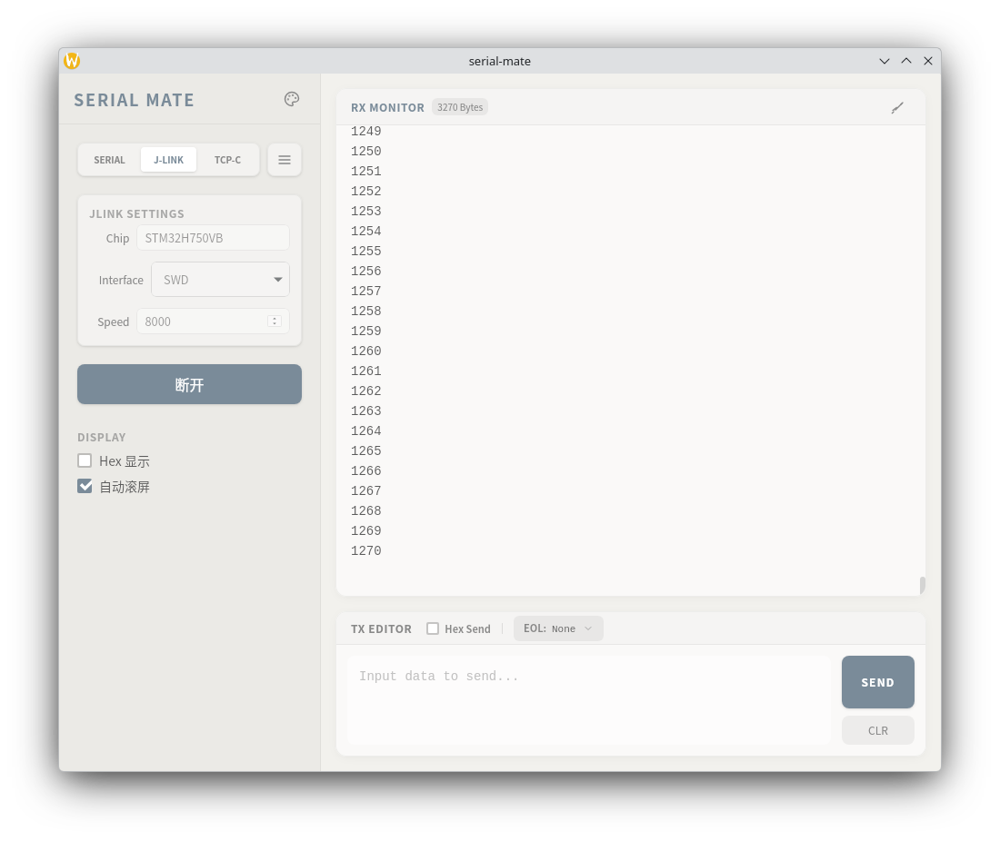

# SerialMateX - 现代化串口调试助手

   

**SerialMateX** 是一款基于 **Go (Wails)** 和 **Vue 3** 构建的跨平台串口调试工具。它摒弃了传统工控软件陈旧的界面，采用了现代化的扁平设计与 **莫兰迪 (Morandi)** 配色风格，致力于为嵌入式开发者提供既美观又高效的调试体验。

## 🧭 界面布局 (Layout)

```
┌────────────┬──────────────────────────────┬────────────┐
│  288px     │        RX MONITOR            │   288px    │
│  SERIAL  TASK ≡ │  （点击接收区，键入即发送）        │  右侧栏     │
│            ├──────────────────────────────┤ （预留）    │
│  SERIAL    │  TX EDITOR（单行输入，默认收起）  │            │
│  SETTINGS  ├──────────────────────────────┤            │
│            │  ▲ TX EDITOR（细长按钮）        │            │
└────────────┴──────────────────────────────┴────────────┘
```

* **左侧标签页**：`SERIAL` 与 `TASK` **并排**；右侧是一个**独立的三横杠按钮**（展开时图标变成叉），按下按原项目的 `dropdown-fade` 动画弹出菜单，菜单里只有 `NETWORK` 一项（字体与 SERIAL/TASK 一致），点它进入网络页（页内再用 `TCP CLIENT` / `TCP SERVER` / `UDP` 子标签切换）。原来的 `PWR-CTRL` 页已删除。
* **显示选项**：`Hex 显示`、`自动滚屏` 移到 **SERIAL 设置面板内**（左侧栏底部不再单独一块），`显示时间戳` 功能已删除。
* **SERIAL 设置顺序**：端口 → 波特率 → 数据位 → **停止位 → 校验位**（两者已互换位置）。**串口打开后仍可自由切换标签页**（连接不会断开）。
* **TASK 页**：上半部分是**设备选择**下拉菜单 + **编辑设备参数**按钮（按钮高度与下拉框一致），数据来自可执行文件同目录的 `pwr_dev.ini`（启动时读取，文件不存在会自动创建模板）。点“编辑设备参数”弹出编辑窗口，可 **新增 / 删除 / 保存 / 取消**：每台设备编辑 4 项 `Name`（设备名称，显示在菜单里）、`Port`（COM 端口）、`PWR-ON`、`PWR-OFF`；保存后**立刻写回 `pwr_dev.ini`**并刷新设备菜单，**设备选择栏会自动切到刚才选中的那台设备**。`PWR-ON` / `PWR-OFF` 可以是**多个十六进制数，用空格分隔**（如 `0x01 0x02 AA`），界面会校验非法字符。键名不区分大小写，`PWR-ON` / `pwr_on` / `PowerOn` 等价，也支持中文键名 `设备名称` / `COM端口`。TASK 页是纯配置页，底部不显示“连接/断开”按钮。

  ```ini
  ; SerialMateX 设备电源控制配置
  [DemoBoard]
  Name=DemoBoard
  Port=COM7
  PWR-ON=0x01 0x02
  PWR-OFF=0x00 0x00
  ```

* **TASK 页（下半部分）**：`保存日志`、`保存功耗`、`初始状态`、`异常暂停` 四行开关，右侧按钮与下方数值框**同尺寸同配色**（64×28），点一下就在 `开` / `关` 之间切换并立即落盘；其中 **`保存功耗` 在当前版本锁定为「关」**（函数未启用：按钮置灰不可点，标签文字与其它行一致，配置里也恒定写 `SavePower=0`），其余三项正常可用。`运行时间`、`间隔时间`、`运行次数` 三项后面带数字与单位（秒 / 秒 / 次），数值框固定为 **4 位数字宽度**，数字靠右、单位（秒 / 次）**始终贴在最右边**不随位数移动，**点击数字弹窗修改**（保存 / 取消），任何改动都**立即写回** exe 同目录的 `task_config.ini` 并刷新界面。打开“编辑设备参数”时，弹窗里标记「● 当前选中」的那台设备与上方设备选择框**保持一致**。`异常暂停` 的含义见下面的任务执行流程。

  ```ini
  [Task]
  SaveLog=0
  SavePower=0
  InitialState=0
  AbnormalPause=0
  WaitSeconds=5
  DelaySeconds=1
  RunCount=1
  ```

* **TASK STATUS（仅 TASK 页显示，位于 TASK SETTINGS 下方）**：五行实时状态——`当前轮次`（显示为 `已运行次数次/运行次数次`，例如 `0次/3次`，分母就是上面的“运行次数”）、`正常次数`（一轮里所有命令都跑完才 +1，从 0 开始，绿色显示）、`电源状态`（`ON` / `OFF`，默认 `OFF`，`ON` 时为绿色）、`下一动作`（实时倒计时 `4 秒后掉电` / `3 秒后上电`；异常暂停时显示「已暂停」，其余时刻显示 `—`）、`当前电流`（**当前版本固定显示 `NULL`**、数值框置灰不可改，标签文字与其它行一致，只保留单位 `A` 的展示位；后续版本接入采样后按**两位整数 + 一位小数**显示，例如 `12.3 A`）。

* **右侧栏 AUTO CMD**：顶部 `AUTO CMD` 标题右侧是同一行、同尺寸的三个按钮 `新增` / `删除` / `导入`（导入会弹出文件选择框读取 `.txt` 并覆盖当前列表；导出入口已按需求移除，但 `auto_cmd.txt` 仍随每次编辑实时落盘，需要备份时直接复制该文件即可）；中间是命令列表——每行最左边是从 1 开始的**序号**，接着是 **TX / RX 标志**（`TX` 绿色、`RX` 红色），中间是命令文本，最右边是**行尾数字（0 ~ 99，**个位数只显示一位并居中**，超两位不可保存）。单击选中，**双击命令文本弹窗编辑**：弹窗里左侧标志可切换 TX / RX，右侧数字框直接改数字（**只允许两位数字，超过两位会提示“只能输入两位数字（00 ~ 99）”并拒绝保存**），`Ctrl+Enter` 或数字框回车保存，清空命令内容后保存即删除该行；已没有单独的数字编辑窗口。有选中时点 `新增` 会**插入到选中这条的上方**，无选中时追加到末尾。列表内容实时写入 exe 同目录的 `auto_cmd.txt`。底部按钮为 `启动` / `停止`：停止时按钮**外围一圈呼吸灯**（缓慢明暗），点一下变为 `停止`，边框改为**顺时针流转的流光**（SVG 描边 + `pathLength` 归一化，整圈按弧长匀速流动，长边短边速度一致），两种状态下的按钮填充色都偏浅。

  **功能键（非字母数字按键）**：命令文本里可以写按键标记，发送时会被替换成对应的控制序列，标记原样保存在配置文件中：

  | 标记 | 发送内容 | 标记 | 发送内容 |
  | --- | --- | --- | --- |
  | `{ENTER}` / `{CR}` | `\r` (0x0D) | `{LF}` | `\n` (0x0A) |
  | `{TAB}` | `\t` (0x09) | `{ESC}` | 0x1B |
  | `{UP}` / `{DOWN}` | `ESC[A` / `ESC[B` | `{LEFT}` / `{RIGHT}` | `ESC[D` / `ESC[C` |
  | `{HOME}` / `{END}` | `ESC[H` / `ESC[F` | `{PGUP}` / `{PGDN}` | `ESC[5~` / `ESC[6~` |
  | `{DEL}` / `{INS}` | `ESC[3~` / `ESC[2~` | `{BS}` / `{BACKSPACE}` | 0x7F |
  | `{SPACE}` | 空格 | `{0xNN}` | 任意单字节（十六进制） |

  例：`AT+RST{ENTER}` → `AT+RST\r`；`{UP}{ENTER}` → `ESC[A\r`；`AT+{0x01}{ENTER}` → `AT+` 后跟 0x01 与回车。标记大小写不敏感；**如果命令末尾既没有 `{ENTER}` 也没有 `{LF}`，程序会自动补一个 `\r`**（与手动输入回车等价）。弹窗里有 15 个功能键按钮，点一下就把标记插到光标处。

  ```text
  # SerialMateX AUTO CMD 命令列表
  # 一行一条命令，格式：TX <命令文本> <数字> / RX <命令文本> <数字>（数字在行尾，0 ~ 99）
  TX AT+RST 0
  RX ready 5
  ```

* **任务执行流程**：只有当 **SERIAL 页成功连上串口**后，右下角 `启动` 才可点击（网络连接会被拒绝）。点下 `启动` 后：
  1. 左侧所有配置与右侧命令列表**全部锁定**（变灰不可编辑），只有 `停止` 可点；
  2. `当前轮次` 置 1，按 `初始状态` 决定是否先上电：初始状态为「关」时通过**当前设备的 PWR-ON** 命令上电并把 `电源状态` 置 `ON`；为「开」则直接置 `ON` 进入下一步；
  3. 自上而下执行命令（严格按列表顺序，空行忽略）：**TX** 把命令文本去掉尾部空白后**自动补一个 `\r`** 再发出（一定能让下位机识别到回车，不受 EOL 设置影响）；**RX** 等待串口收到的数据里出现该命令文本（不匹配就一直等），且**只认本轮、本命令开始等待之后收到的数据**（每轮开始与每条 RX 命令前都会清空接收缓存，上一轮的残留数据不会被误判）。当前命令会**高亮**（执行中为主色，等待间隔时为绿色），执行完该命令后，行尾数字开始**倒计时**（`0` 表示不等待），倒计时归零跳到下一条；
  4. 运行时间到后发 **PWR-OFF** 掉电（`电源状态` → `OFF`），TASK STATUS 全程实时显示 `N 秒后掉电` / `N 秒后上电`；
  5. 等待 `间隔时间` 后再上电，重复上述步骤，共执行 `运行次数` 轮，结束后自动停止。
  * **正常次数**：某一轮里命令全部执行完 → +1；若掉电时还有命令没执行完（RX 一直没匹配到），本轮不计入正常。
  * **异常暂停**：掉电时若还有命令没跑完，且该项为「开」，则程序暂停、**不关闭电源**、保留当前状态，TASK STATUS 显示「已暂停」并出现红色`继续（解除异常暂停）`按钮；该项为「关」时照常掉电继续下一轮，但「正常次数」不增加。
  * **保存日志**：开启后本轮测试开始时在 exe 同目录创建 `DEBUGLOG_YYYY-MM-DD_HH-MM-SS.log`；每次上电写入用 `*` 框住的起始标识（第 N 次上电 + 当前电源设备名），掉电后写入停止标识，中间实时追加被测设备串口收到的内容。文件**不长期占用句柄**（每次写完即关闭），编辑器等程序可随时打开查看。
  * **保存功耗**：**当前版本置灰、固定为「关」**（采样链路尚未启用）；开关置灰后不再创建 `CURRENT_*.csv`，`task_config.ini` 里也恒定写 `SavePower=0`。后续版本启用时的约定是：创建 `CURRENT_YYYY-MM-DD_HH-MM-SS.csv`，上电期间每 0.5 秒采样一次，英文逗号分隔、每 50 个数据换行，同样不占用文件。

* **RX MONITOR**：不再有单独的输入条。**点击接收区后直接键入即发送**（终端式，逐字符发出）：`Enter` 只发**一个**回车符（EOL 为 `LF` 时发 `\n`，其余情况发 `\r`；不会再发 `\r\n`，避免下位机同时接受 CR/LF 时出现"两次回车"）、`↑` / `↓` 翻最近 50 条历史命令（会擦除当前行并重放，不影响接收区滚动）、`Backspace` 发 `0x7F`、`Ctrl+C` 发 `0x03`、`Tab` 发 `\t`；`Ctrl/Alt/Cmd` 组合键（复制等）仍交给浏览器。接收显示按终端语义处理后位机回显：`\b`（含下位机回显的 `"\b \b"`）真正删掉一个字符、`\r\n` 只落一行、单独的 `\r` 也换行，其它控制字符丢弃，因此退格与翻历史不会再在接收区堆出乱码。
   * **复制**：在接收区选中文本后按 `Ctrl+C` 走系统复制（此时**不会**发 `0x03`），可直接粘到其它程序；
   * **粘贴**：接收区按 `Ctrl+V` 会把剪贴板文本**直接发给下位机**（`\r\n` / `\n` 统一按 `\r` 发送），方便一次灌入多行命令。
* **TX EDITOR**：单行输入框，**默认收起**，**编辑后回车发送**（发送后清空，`↑` / `↓` 翻最近 50 条历史；EOL 默认 `\r\n`）；不再有 SEND / CLR 按钮。其下方的**细长按钮始终固定在整列最底部**，用于展开 / 收起 TX EDITOR；展开时 RX MONITOR 自动向上收缩，收起时自动向下扩展。
* **右侧栏**：宽度与左侧栏一致（288px），不随窗口缩放变化；内容为 **AUTO CMD** 命令面板（见上）。
* **窗口限制**：中间栏最小宽度为左侧栏的 2 倍（576px），因此窗口最小宽度为 288 + 576 + 288 = 1152px（代码里 `MinWidth: 1200` 留出边框余量）；启动尺寸 **1280×820**，最小高度也改为 **820px**，以保证 TASK 页能完整显示 TASK STATUS（客户区 768px + 标题栏余量）。



## ✨ 主要功能 (Features)

### 🎨 极致 UI/UX 体验
* **莫兰迪设计风格**: 默认采用低饱和度的莫兰迪配色。
* **动态主题引擎**:
    * 内置 5 款精选预设（雾霾蓝、豆沙绿、干燥玫瑰、极致灰、烟熏紫）。
    * **RGB 自由调色**: 支持通过 RGB 滑动条实时自定义主色调，界面背景、按钮、滚动条及高亮元素会自动根据主色计算并适配。
    * 无延迟响应：基于 CSS 变量与 RGB 直通技术，调色极其丝滑，无闪烁。
* **现代化交互**:
    * 卡片式布局 (Rx Monitor / Tx Editor)。
    * 毛玻璃 (Backdrop Blur) 视觉效果。
    * 灵动的微交互动画（如清空数据的“扫把”摆动动画）。

### 🛠 全能连接支持
* **串口 (Serial Port)**:
    * **波特率**: 支持标准波特率选择，也支持**手动输入任意波特率**。
    * **数据位**: 5, 6, 7, 8。
    * **校验位**: None, Odd, Even, Mark, Space。
    * **停止位**: 1, 1.5, 2。
* **网络调试 (Network)**:
  * **TCP Client**: 作为客户端连接远程服务器。
  * **TCP Server**: 本地开启服务监听连接。
  * **UDP**: 支持点对点 UDP 通信。
* **RTT (Real Time Transfer)**: 


### 📡 数据收发监控
* **接收 (RX)**:
    * **Hex / ASCII 切换**: 支持一键切换十六进制与文本显示。
    * **智能解码**: 内置 Base64 解码与 UTF-8 文本解码，完美解决中文乱码与特殊字符显示问题。
    * **自动滚屏**: 数据更新时自动锁定到底部，可随时暂停查看历史数据。
    * **字节统计**: 实时统计接收到的字节总数。
* **发送 (TX)**:
    * 支持文本发送与 Hex (十六进制) 发送。
    * 快捷清空发送区。

### 📊 实时绘图 (Real-time Plotting)
支持两种协议格式，满足不同场景需求：

* **字符串格式 (String Protocol)**:
    * 格式: `&DRAW,Data1,Data2...#\n`
    * 示例: `&DRAW,1.5,2.3,-0.8#\n`
    * 说明: 以 `&DRAW` 开头，`#` 结尾，中间为逗号分隔的浮点数。支持多通道同时绘图。

* **十六进制格式 (Hex Protocol)**:
    * 格式: `[Float32 LE] [Float32 LE] ... 00 00 80 7F`
    * 示例: `CD CC 8C 3F 00 00 80 7F` (1.1)
    * 说明: 数据段由若干个 **32位小端浮点数** 组成，以固定后缀 `0x00 0x00 0x80 0x7f` 作为包结束符。

### 🔄 自动更新
* **一键检查更新**: 点击工具栏的 "关于" 按钮即可检查是否有新版本可用。
* **自动下载与安装**: 发现新版本后，可直接在应用内下载并安装更新，无需手动下载。
* **智能版本比较**: 自动从 GitHub Releases 获取最新版本，并与当前版本进行比较。
* **实时下载进度**: 显示下载进度条和速度，让更新过程一目了然。
* **跨平台支持**: 支持 Windows、macOS 和 Linux 平台的自动更新。

## 🛠 技术栈 (Tech Stack)

* **后端 (Backend)**: Go (Golang)
    * 框架: [Wails v2](https://wails.io/)
    * 串口库: `go.bug.st/serial`
* **前端 (Frontend)**: TypeScript
    * 框架: Vue 3 (Composition API)
    * 构建工具: Vite 6
    * 样式库: **Tailwind CSS v4**

## 📦 安装 (Installation)

### Windows & macOS

从 [Releases](https://github.com/TheWinds071/serial-mate/releases) 页面下载对应平台的安装包：
* **Windows**: 下载 `.exe` 文件直接运行
* **macOS**: 下载 `.app.zip` 文件解压后运行

### Linux

#### 推荐：使用包管理器安装

Serial Mate 提供了针对不同 Linux 发行版的原生包，推荐通过包管理器安装以获得最佳体验：

**Ubuntu / Debian:**

```bash
# Ubuntu 22.04 / Debian 12 (webkit 4.0)
wget https://github.com/TheWinds071/serial-mate/releases/download/vX.X.X/serial-mate-X.X.X-ubuntu-22.04-amd64.deb
sudo dpkg -i serial-mate-X.X.X-ubuntu-22.04-amd64.deb
sudo apt-get install -f  # 自动安装依赖

# Ubuntu 24.04 及更新版本 (webkit 4.1)
wget https://github.com/TheWinds071/serial-mate/releases/download/vX.X.X/serial-mate-X.X.X-ubuntu-24.04-amd64.deb
sudo dpkg -i serial-mate-X.X.X-ubuntu-24.04-amd64.deb
sudo apt-get install -f
```

**Fedora:**

```bash
# Fedora 40/41
sudo dnf install https://github.com/TheWinds071/serial-mate/releases/download/vX.X.X/serial-mate-X.X.X-fedora40-amd64.rpm
```

安装后，可以从应用菜单启动 Serial Mate，或在终端运行：

```bash
serial-mate
```

#### 使用原始二进制文件

如果您的发行版不在上述列表中，也可以下载原始二进制文件：

```bash
# 下载二进制文件
wget https://github.com/TheWinds071/serial-mate/releases/download/vX.X.X/serial-mate-linux-amd64
chmod +x serial-mate-linux-amd64
./serial-mate-linux-amd64
```

**注意**: 运行原始二进制文件需要系统已安装 WebKitGTK 库。根据您的发行版安装对应依赖：

```bash
# Ubuntu 22.04 / Debian 12
sudo apt-get install libgtk-3-0 libwebkit2gtk-4.0-37

# Ubuntu 24.04 及更新版本
sudo apt-get install libgtk-3-0 libwebkit2gtk-4.1-0

# Fedora
sudo dnf install gtk3 webkit2gtk4.1

# Arch Linux
sudo pacman -S gtk3 webkit2gtk
``` 
